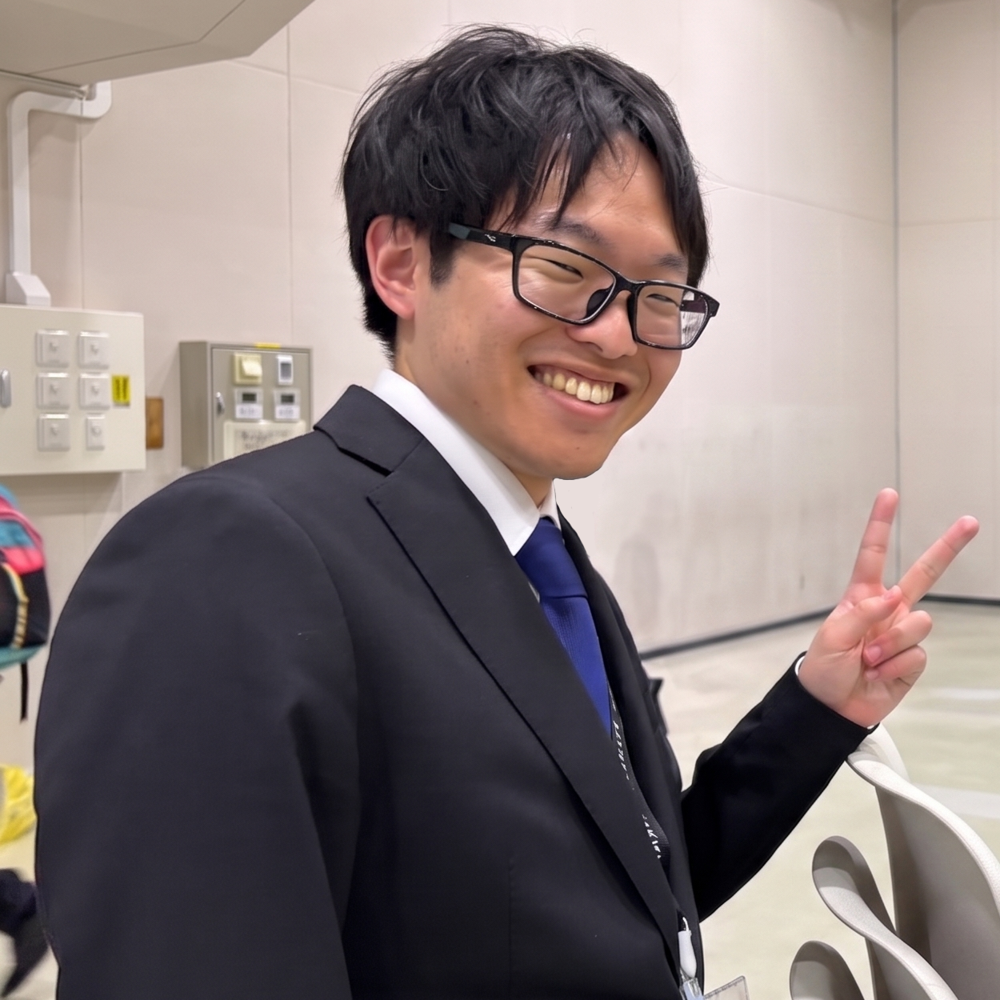
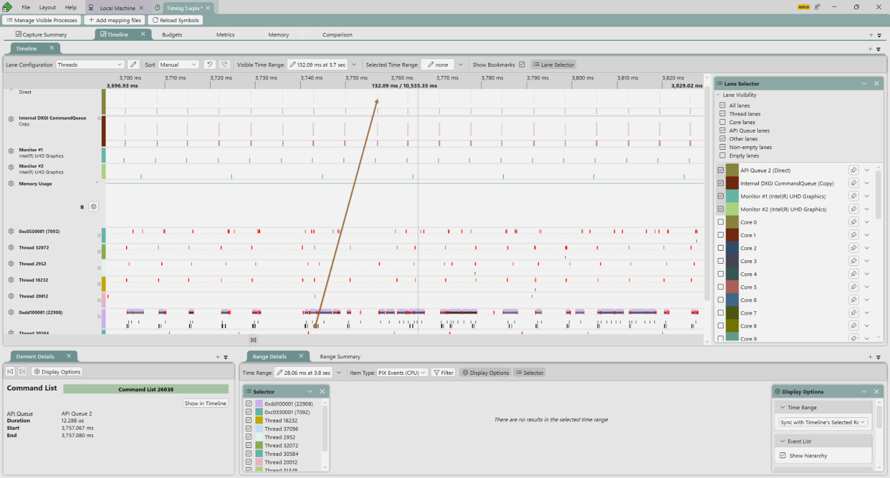
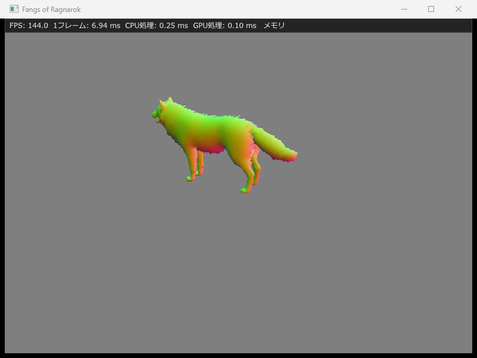
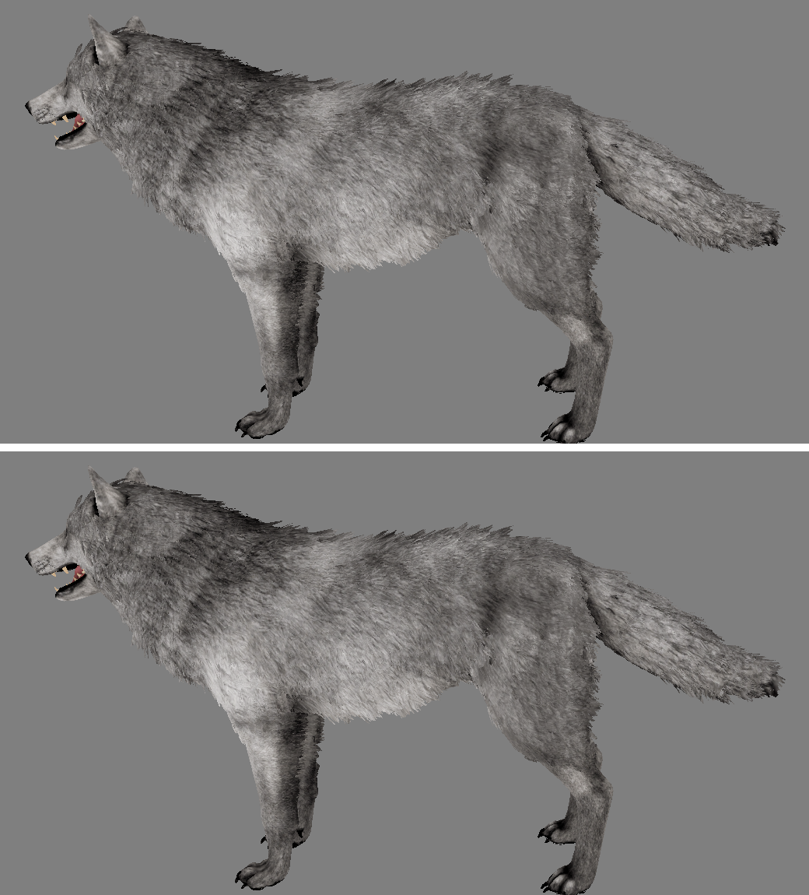
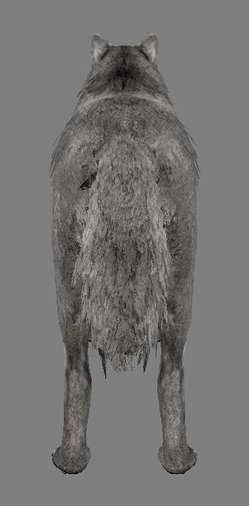
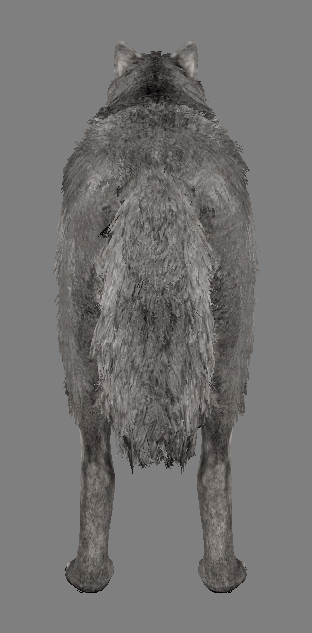
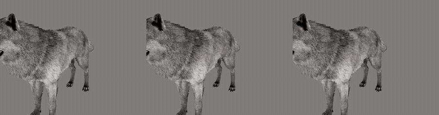

<style>
/* ===== 霜と鉄のテーマ ===== */

html {
    background: #f7f8f9;
}

body {
    max-width: 960px;
    margin: 0 auto;
    padding: 32px 40px 80px;
    background: #ffffff;
    color: #24292f;
    font-family: "Yu Gothic UI", "Meiryo", sans-serif;
    line-height: 1.8;
    border-left: 1px solid #dde2e7;
    border-right: 1px solid #dde2e7;
}

h1 {
    margin: 24px 0 8px;
    color: #1f2a36;
    font-size: 2.6em;
    letter-spacing: 0.12em;
    text-align: center;
    border-bottom: 3px solid #c45c34;
    padding-bottom: 10px;
}

h2 {
    margin-top: 56px;
    padding: 8px 14px;
    color: #ffffff;
    background: linear-gradient(90deg, #1f2a36 0%, #3b4d60 100%);
    border-left: 6px solid #c45c34;
    border-radius: 2px;
}

h3 {
    margin-top: 40px;
    color: #1f2a36;
    border-bottom: 2px solid #8fa3b6;
    padding-bottom: 4px;
}

h4 {
    margin-top: 28px;
    color: #3b4d60;
    border-left: 4px solid #c45c34;
    padding-left: 8px;
}

a {
    color: #2f5d86;
    text-decoration: none;
}

a:hover {
    color: #c45c34;
    text-decoration: underline;
}

hr {
    border: none;
    height: 2px;
    margin: 32px 0;
    background: linear-gradient(90deg, transparent, #8fa3b6, transparent);
}

img {
    max-width: 100%;
    border: 1px solid #dde2e7;
    border-radius: 4px;
}

table {
    border-collapse: collapse;
    margin: 16px 0;
    width: 100%;
}

table > thead > tr > th {
    background: #3b4d60;
    color: #ffffff;
    padding: 8px 12px;
    text-align: left;
    border: 1px solid #3b4d60;
}

table > tbody > tr > td {
    padding: 8px 12px;
    border: 1px solid #dde2e7;
    vertical-align: top;
}

table > tbody > tr:nth-child(even) > td {
    background: #f3f5f7;
}

table > tbody > tr:hover > td {
    background: #fbefe9;
}

pre {
    background: #1f2a36;
    border-radius: 4px;
    padding: 12px 16px;
    overflow-x: auto;
}

pre code {
    color: #e6edf3;
    background: transparent;
}

:not(pre):not(.hljs) > code {
    background: #eef1f4;
    color: #8a3a1c;
    padding: 1px 6px;
    border-radius: 3px;
}

details {
    margin: 12px 0;
    border: 1px solid #dde2e7;
    border-radius: 4px;
    background: #fafbfc;
}

details > summary {
    cursor: pointer;
    padding: 8px 12px;
    font-weight: bold;
    color: #1f2a36;
    list-style: none;
}

details > summary::before {
    content: '▶ ';
    color: #c45c34;
}

details[open] > summary::before {
    content: '▼ ';
}

details > summary:hover {
    background: #f3f5f7;
}

details > ul {
    margin: 0 12px 12px;
}

blockquote {
    margin: 16px 0;
    padding: 8px 16px;
    color: #3b4d60;
    background: #f3f5f7;
    border-left: 4px solid #8fa3b6;
}

strong {
    color: #8a3a1c;
}

p > a[href*="%E7%9B%AE%E6%AC%A1"] {
    display: inline-block;
    margin-top: 8px;
    padding: 2px 12px;
    font-size: 0.9em;
    color: #ffffff;
    background: #3b4d60;
    border-radius: 12px;
    transition: transform 0.15s, box-shadow 0.15s;
}

p > a[href*="%E7%9B%AE%E6%AC%A1"]:hover {
    transform: translateY(-2px);
    box-shadow: 0 5px 14px rgba(59, 77, 96, 0.4);
    text-decoration: none !important;
}
</style>

# FANGS OF RAGNAROK

---

説明資料：https://takebayashinaoya.github.io/FANGS-OF-RAGNAROK_Portfolio.github.io/  
ソースコード：https://github.com/TakebayashiNaoya/FANGS-OF-RAGNAROK  
ROM：https://github.com/TakebayashiNaoya/FANGS-OF-RAGNAROK/releases/tag/rom-latest  

---

## 自己紹介
### 氏名：竹林尚哉（たけばやしなおや）
 

本校に入学する前は、3年間溶接工として働いておりました。  
将来のキャリアを考えたとき、やはり好きなことを仕事にしたいと考え、ゲームプログラマーを目指すようになりました。
 

**趣味** : ドライブ、旅行  
**特技** : 溶接  
**休日の過ごし方** : 積みゲーの消化、ネッ友とゲーム  
**好きなゲームジャンル** : MMO、FPS、RPG、謎解き、サンドボックス、レース  
**最近遊んだゲーム** : サブノーティカ2、リズム天国、スターフォックス

**長所** :   
- **行動力** : 何をするにしても動き出しが速く、躊躇いがありません。試行回数が増える分、リカバリーも速いです。
- **正直者** : 言い訳や嘘をつくのが嫌い（できない）です。そのため、前職でも信用して仕事を任せていただいていました。
- **大体なんとかできる** : 時間がなくても大体なんとかできます。前職では「間に合わないはありえない」と口癖のように言われてきました。そのような環境に身を置いたことで、「間に合わない」のではなく「間に合わせようとしていない」だけだと気付きました。それ以降、緊急の仕事が舞い込んできても、きちんと期日までに終わらせてきました。

---

## 目次

- [1. プロジェクト概要](#1-プロジェクト概要)
  - [作品概要](#作品概要)
  - [ゲーム内容](#ゲーム内容)
  - [担当ソースコード](#担当ソースコード)
- [2. 作り方](#2-作り方)
- [3. エンジンの基盤](#3-エンジンの基盤)
  - [メモリの使い方を見えるようにする](#メモリの使い方を見えるようにする)
  - [エラーの出し方を1つにする](#エラーの出し方を1つにする)
  - [数学ライブラリ](#数学ライブラリ)
  - [3つのビルド構成](#3つのビルド構成)
- [4. 描画の土台](#4-描画の土台)
  - [CPUとGPUを重ねて動かす](#cpuとgpuを重ねて動かす)
  - [GPUの時間を測る](#gpuの時間を測る)
  - [パイプラインと定数バッファ](#パイプラインと定数バッファ)
- [5. モデルの読み込み](#5-モデルの読み込み)
  - [どの形式から焼くか](#どの形式から焼くか)
  - [焼くものと毎フレーム計算するもの](#焼くものと毎フレーム計算するもの)
  - [頂点バッファはUPLOADのまま](#頂点バッファはuploadのまま)
- [6. テクスチャ](#6-テクスチャ)
  - [DDSとBC圧縮](#ddsとbc圧縮)
  - [解像度は1024までにした](#解像度は1024までにした)
  - [sRGBは区分式で戻す](#srgbは区分式で戻す)
  - [毛だけ裏面も描く](#毛だけ裏面も描く)

---

## 1. プロジェクト概要

### 作品概要

| 項目 | 内容 |
|------|------|
| タイトル | FANGS OF RAGNAROK |
| 制作人数 | 1人 |
| 製作期間 | 2026年9月～現在 |
| ゲームジャンル | 3Dアクション（ソウルライク） |
| プレイ人数 | 1 |
| 対応ハード | PC (Windows 11) / Xbox One（UWP、対応予定） |
| 使用言語 | C++20、HLSL |
| エンジン | 自作（DirectX12） |
| 使用ライブラリ | Dear ImGui、DirectXMath |
| 使用ツール | Visual Studio 2026<br>PIX<br>Blender<br>texconv<br>GitHub<br>Plastic SCM |
| GitHub URL | [https://github.com/TakebayashiNaoya/FANGS-OF-RAGNAROK](https://github.com/TakebayashiNaoya/FANGS-OF-RAGNAROK) |

前作の「ぺんたくと」は、学校内製エンジンの上に作りました。  
今作は、エンジンを1から自作しています。  
内製エンジンに「用意されていたもの」が、なぜその形なのかを自分で説明できるようになりたかったためです。

[⇑目次に戻る](#目次)

### ゲーム内容

北欧神話を世界観とした3Dアクションゲームです。  
プレイヤーは狼1匹を操作して神々の軍勢と戦い、最終ボスのオーディンを倒すとクリアです。  
5分間の雑魚戦でレベルとアイテムを集め、5分たつとオーディン戦に入ります。

[⇑目次に戻る](#目次)

### 担当ソースコード

1人で制作しているため、`ThirdParty/` 以外はすべて自分で書いています。

<details>
<summary>エンジン（FangEngine）</summary>

- FangEngine/
  - Main.cpp
  - Application (.cpp / .h)
  - Core/
    - Log (.cpp / .h)
    - Noncopyable.h
    - Memory/
      - Memory (.cpp / .h)
    - Math/
      - Math.h
      - Vector.h
      - Matrix.h
      - Quaternion.h
  - Render/
    - RenderContext (.cpp / .h)
    - DebugOverlay (.cpp / .h)
    - CpuProfiler (.cpp / .h)
    - GpuProfiler (.cpp / .h)
    - Shader (.cpp / .h)
    - RootSignature (.cpp / .h)
    - PipelineState (.cpp / .h)
    - ConstantBuffer (.cpp / .h)
    - VertexBuffer (.cpp / .h)
    - IndexBuffer (.cpp / .h)
    - Model (.cpp / .h)
    - ModelData (.cpp / .h)
    - ModelPass (.cpp / .h)
    - Texture (.cpp / .h)
    - TextureData (.cpp / .h)
  - Shaders/
    - ModelVertexShader.hlsl
    - ModelPixelShader.hlsl

</details>

[⇑目次に戻る](#目次)

---

## 2. 作り方

#### 1段ずつ、比べてから決める

描画は段に分けて、1段ずつ作っています。  
段ごとに「ライブラリを使う案」と「自作する案」を表に並べ、どちらにするかを決めてから書きました。  
自作するのは、中身を説明できるようにしたい所だけです。標準ライブラリやDirectXMathで足りる所は、そちらを使っています。

#### 動きを変える段と、動きを変えずに移す段を分ける

`Main.cpp` に1枚で書いた初期化と描画を、`RenderContext` と `Application` に移すときは、「動きを変えずに移す」段と「動きを変える」段を分けました。  
1度に両方をやると、壊れたときにどちらが原因かわからなくなるためです。

#### 測ってから決める

「速そうだから」では決めず、PIXで測った数字か、測らなくても差の上限がわかる理由で決めるようにしています。  
この資料の数字は、すべて自分の環境（RTX 4060 Laptop）で測ったものです。

[⇑目次に戻る](#目次)

---

## 3. エンジンの基盤

### メモリの使い方を見えるようにする

`malloc` を包む `Memory` クラスを作りました。  
確保するときに文字列のタグを付けてもらい、まだ解放されていないメモリの一覧（サイズとタグ）を、ImGuiの窓に出せるようにしています。  
1つずつの一覧を持つのはDebugとProfileの構成だけで、Releaseでは合計の大きさと数だけを数えます。

`Memory` を破棄したときに残っているメモリは、あえて解放しません。  
まとめて解放すると、解放し忘れが見えなくなるためです。

フレームの中だけで使う一時的な領域は、`StackAllocator` を自作せず、`std::pmr::monotonic_buffer_resource` を使う予定です。  
標準ライブラリで同じことができるため、自作するのは使い方を見えるようにする所だけで足りると判断しました。

[⇑目次に戻る](#目次)

### エラーの出し方を1つにする

エラーの出し方を `core::LogError` と `core::LogIfFailed` の2つにまとめ、コンソールの窓を消しました。  
`LogIfFailed` は、失敗していたらメッセージを出して `true` を返します。`HRESULT` を受け取る所は、すべて次の形で書いています。

```c++
if (core::LogIfFailed(createResult, L"デバイスを作れなかった"))
{
    return false;
}
```

`if` と `return` をまとめるマクロは作りませんでした。  
マクロにすると行は短くなりますが、関数から抜ける `return` が呼ぶ側から見えなくなるだけだと考えたためです。

[⇑目次に戻る](#目次)

### 数学ライブラリ

`Vector2`〜`Vector4`、`Matrix`、`Quaternion` を作りました。  
型は値と定数だけを持つ `struct` にし、計算は型の外の関数にしています。

| 案 | 採らなかった理由 |
|---|---|
| 逆行列やSlerpも自作する | 時間をエンジンの設計に使いたいため。`Matrix` と `Quaternion` の計算はDirectXMathを包んだ |
| `Vector` をSIMDの型で持つ | 3〜4要素では、レジスタへの出し入れの分で速さが変わらないため |

座標系は左手系、ベクトルは行ベクトル（`world * view * projection` の順に掛ける）にそろえました。DirectXMathと同じ決まりです。

[⇑目次に戻る](#目次)

### 3つのビルド構成

| 構成 | 最適化 | 計測と窓 | 使いどころ |
|---|---|---|---|
| Debug | なし | あり | デバッグレイヤーでエラーを読む |
| Profile | あり | あり | 時間を測る |
| Release | あり | なし | 配るROM |

最初はDebugとReleaseの2つでしたが、Debugは最適化がないため時間を測っても意味がなく、Releaseは計測の窓が出ません。  
そこで、最適化したまま計測できるProfileを足しました。  
`_DEBUG` はProfileでは定義されないため、`FANG_DEBUG_OR_PROFILE` という自分の定義に置き換えています。  
Releaseでは計測の関数を空にして、呼ぶ側には `#ifdef` を書かずに済むようにしました。

[⇑目次に戻る](#目次)

---

## 4. 描画の土台

### CPUとGPUを重ねて動かす

コマンドアロケーターと定数バッファを、スワップチェーンのバッファの数だけ持つようにしました。  
1つしかないと、CPUはGPUが前のフレームを描き終わるまで次の指示を書けません。  
バッファの数だけ持つことで、CPUが次のフレームを書いている間にGPUが前のフレームを描けるようになり、1フレームの時間が「CPU＋GPU」から「遅いほう」になります。

[⇑目次に戻る](#目次)

### GPUの時間を測る

`steady_clock` で測れるのは、CPUがGPUに指示を渡した時刻までです。GPUが実際に描いた時間は読めません。  
そこで、フレームの最初と最後にGPUのタイムスタンプを書かせる `GpuProfiler` を作りました。  
値はGPUが書き終わってからでないと読めないため、同じ番号のフェンスを待ってから読みます。窓に出るのは2フレーム前の値です。

自分の計測が正しいかは、PIXで同じフレームを測って確かめました。

| 計測 | 値 |
|---|---|
| 自作の窓（GPU処理） | 0.01ms |
| PIX（コマンドリストの実行時間） | 12.288µs（約0.012ms） |

 

[⇑目次に戻る](#目次)

### パイプラインと定数バッファ

#### パイプラインは起動時に作る

`PipelineState`（PSO）は、起動時に作ってフレームの中では作りません。  
作るときにシェーダーのコンパイルが走り、その間フレームが止まるためです。

#### 行列はルートCBVで渡す

行列は、デスクリプタヒープを通さず、ルートシグネチャに直接置いた定数バッファ（ルートCBV）で渡しています。  
HLSLの側は `row_major` と宣言し、CPUの行ベクトルの並びのまま読ませました。  
CPUで毎回転置する案もありましたが、転置を忘れても警告が出ないため採りませんでした。

#### 深度バッファ

深度は `D32_FLOAT` にしました。  
遠くの精度を上げるReverse-Zは、遠くのちらつきが実際に見えたときに入れることにしています。

[⇑目次に戻る](#目次)

---

## 5. モデルの読み込み

狼のモデル（7メッシュ、20,276頂点、23,744三角形、骨57本）を読み込んで描きました。  
最初の段では、テクスチャの前に法線の色で描き、形と向きが正しいかを確かめています。

 

### どの形式から焼くか

ゲームが起動するたびにJSONを読んで座標系を直すのは無駄なため、事前に自作の形式 `.fmodel` に焼いておき、ゲームはバイト列を写すだけにしました。  
問題は、何から焼くかでした。

| 案 | 判断 |
|---|---|
| FBXから直接焼く | 採らない。FBXは非公開の形式で、読むのにC++のライブラリが要る。この狼はテクスチャの付き方が崩れていて、Blenderで付け直している。直接読むと、その直しをもう一度作ることになる |
| OBJ | 採らない。骨とアニメーションが入らない |
| ゲームがglTFを直接読む | 採らない。起動のたびにJSONの解析と座標の反転が走る |
| **FBX ➡ glTF ➡ `.fmodel`** | **採る**。アニメーションも同じglTFから読むため、モデルとアニメーションで骨の並びがずれない |

glTFは右手系、エンジンは左手系のため、焼くときにz座標を反転しています。  
zを反転すると三角形の表の向きも逆になるため、インデックスの2番目と3番目も入れ替えました。

[⇑目次に戻る](#目次)

### 焼くものと毎フレーム計算するもの

素材だけで決まるもの（頂点の座標、インデックス）は焼き、遊んでいる間に変わるもの（ワールド行列、アニメーションのブレンド、IK）は毎フレーム計算する、と分けました。  
ブレンドとIKは、頂点（20,276個）ではなく骨（57本）にかけるため、毎フレームでも軽く済みます。

ファイルを読む `LoadModel` と、GPUのバッファを作る `Model` の間には、`ModelData` という中身だけの型を挟みました。  
読み込みを別のスレッドに出すときに、「読む」と「GPUに作る」を別の仕事に分けられるようにするためです。

[⇑目次に戻る](#目次)

### 頂点バッファはUPLOADのまま

頂点バッファは、GPUから読むのが速い `DEFAULT` ヒープに移すのが普通です。  
ただ、移すにはコピー用のコマンドリストと、コピーの完了を待つ処理が要ります。

狼を描いたフレームでGPUの時間を測ると、1フレーム全体で0.10msでした（Profile、800×600）。  
`DEFAULT` に移して縮むのは、この0.10msの中の頂点を読む分だけです。比べる前から差が0.1msより小さいとわかったため、`UPLOAD` のままにしました。

[⇑目次に戻る](#目次)

---

## 6. テクスチャ

### DDSとBC圧縮

PNGはファイルとしては圧縮されていますが、GPUはPNGを読めないため、1ピクセル4バイトに展開してから載せることになります。  
そこで、GPUが圧縮したまま読めるBC形式のDDSにしました。ベースカラーは `BC7_UNORM_SRGB`（1ピクセル1バイト）、毛の透明度は1チャンネルの `BC4_UNORM`（1ピクセル0.5バイト）です。  
DDSは、ファイルの大きさがそのままGPUのメモリの大きさになります。

| テクスチャ | PNGのファイル | PNGを展開してGPUに載せた場合 | DDS（1024に縮めたもの） |
|---|---|---|---|
| 体のベースカラー | 42.2MB | 89.5MB | 1.4MB |
| 毛の透明度 | 3.8MB | 89.5MB | 0.7MB |
| 口のベースカラー | 4.0MB | 22.4MB | 1.4MB |
| 目 | 0.04MB | 0.35MB | 0.09MB |
| **合計** | 50.0MB | 201.7MB | **3.6MB** |

「PNGを展開してGPUに載せた場合」は、元の解像度のまま1ピクセル4バイトに展開し、ミップを全段付けたときの計算値です。  
体・毛・口は、次の項目のとおり1024に縮めています。

DDSは、もうGPUが読む並びになっているため、独自の形式は作っていません。  
読み込みには、DirectXTK12の `CreateDDSTextureFromFile` を使う案もありました。中身が同じ処理だと確かめたうえで、行の幅を256バイトの倍数にそろえて写す所を自分で説明できるようにしたかったため、自作しました。

テクスチャのないマテリアルには、1×1の白いテクスチャを貼り、色の係数だけで色を付けています。  
テクスチャの有無で、シェーダーとルートシグネチャを分けずに済むようにするためです。

[⇑目次に戻る](#目次)

### 解像度は1024までにした

素材のテクスチャは4096×4096でした。2048と1024に縮めて、4096と見た目と数字を比べました（1920×1080、狼から1.6mのカメラで撮影。3つは同じ回に測り、PIXは5回の中央値）。

| 項目 | 4096 | 2048 | 1024 |
|---|---|---|---|
| DDSの合計 | 39.2MB | 14.1MB | 3.6MB |
| GPUのメモリ（プロセス全体） | 98.3MB | 74.3MB | 64.3MB |
| 読み込み | 48〜53ms | 20〜22ms | 10ms |
| モデルのドローの合計（PIX、横） | 122.9µs | 122.9µs | 117.8µs |
| 1フレームのGPU時間 | 0.18〜0.19ms | 0.18〜0.19ms | 0.18〜0.19ms |

2048では、見た目もGPUの時間も4096と同じでした。GPUは画面に映る大きさに合ったミップから読むため、この距離では4096の一番上の段が使われていなかったためです。  
1024ではドローが約5µs速くなりましたが、1フレーム全体では差が見えない大きさでした。  
最初は2048にしましたが、Xboxで動かすときは一辺1024以内が目安だと指摘を受け、1024でも比べました。

 

上が4096、下が1024です。寄ったカメラでは、尻尾や胴の横の明るい毛で、筋が少しぼけます。  
ふだんのカメラの距離ではほとんど見分けられないため、Xboxの目安に合わせて1024にしました。

#### 1024を超えるテクスチャは読まない

縮め忘れた素材がそのままXboxに載らないよう、DDSのヘッダーを読んだ所で幅と高さを確かめています。  
どちらかが1024を超えていれば、ファイルのパスと解像度をエラーで出し、読み込みをやめます。ピクセルを読む前に止まるため、大きい素材がメモリに載ることもありません。

警告だけ出して読み進める案もありました。  
ただ、UWPでは `MessageBoxW` が使えず、Xboxでは出力の窓にしか出ないため、気づかないまま載ってしまいます。素材は変換ツールで焼き直せばすぐ直るため、止めるほうを選びました。

[⇑目次に戻る](#目次)

### sRGBは区分式で戻す

テクスチャは `_SRGB` の形式で読み、ピクセルシェーダーの最後で線形からsRGBに戻しています。  
描き先を `_SRGB` にすればGPUが戻してくれますが、そうするとImGuiの窓が白っぽくなったため、描き先は `UNORM` のままにしました。

戻す式は、よく見る `pow(c, 1/2.2)` ではなく、GPUと同じ区分式にしています。  
`pow` だと暗い所ほどずれ、`.dds` の値10が18に浮くことを確かめたためです。

```hlsl
float3 LinearToSrgb(float3 linearColor)
{
    linearColor = saturate(linearColor);
    float3 low  = linearColor * 12.92f;
    float3 high = 1.055f * pow(linearColor, 1.0f / 2.4f) - 0.055f;
    return linearColor <= 0.0031308f ? low : high;
}
```

[⇑目次に戻る](#目次)

### 毛だけ裏面も描く

狼の毛は、透明度のテクスチャで抜いた板を6,332枚重ねて作られています。  
板は表からしか描かれないため、後ろから見ると毛が消えました。

そこで、裏面も描く3通りを比べました（1920×1080、横から撮影、PIXで5回測った中央値）。

| 案 | モデルのドローの合計 | 体のピクセルシェーダーの回数 | 判断 |
|---|---|---|---|
| 裏面を描かない | 102.4µs | 206,623 | 採らない。後ろから見ると毛が消える |
| 狼全体で裏面も描く | 133.1µs | 415,303 | 採らない。閉じた体の裏面にもピクセルシェーダーが走り、回数が倍になる |
| **毛だけ裏面も描く** | 133.1µs | 206,623 | **採る** |

  

左が裏面を描かない場合、右が毛だけ裏面も描いた場合です。

 

今はピクセルシェーダーが軽く、「全体」と「毛だけ」で時間の差は出ていません。  
それでも「毛だけ」にしたのは、ピクセルシェーダーの回数が半分で済むためです。ライティングを入れて重くなったら、測り直します。

実装は、カリングだけを変えたPSOを2つ作り、メッシュを描くたびに、透明度で抜くメッシュかどうかでセットし直しています。  
PSOはコマンドリストに一度セットすると、次にセットし直すまで残るためです。  
抜くメッシュを最後にまとめて描けば切り替えは1回で済みますが、狼のドローは7回しかなく、並べ替える手間のほうが大きいため採りませんでした。

[⇑目次に戻る](#目次)
